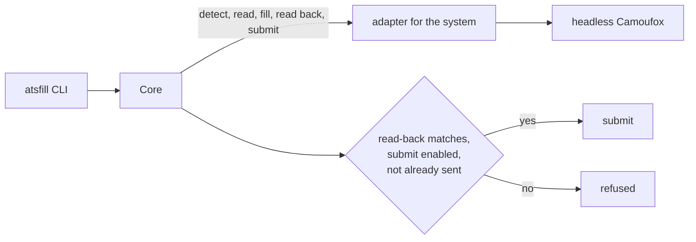

<div align="center">

# atsfill

Let your agent apply for you. One CLI for every hiring system.

[![PyPI][pypi-badge]][pypi]
[![Python][python-badge]][pypi]
[![CI][ci-badge]][ci]
[![License][license-badge]][license]

---

[Install](#install) • [Quickstart](#quickstart) • [How it works](#how-it-works) • [Docs](docs/adr/README.md)

---

</div>

atsfill reads the application form behind a job posting, fills it with your answers, and checks what the hiring system will receive before anything is sent.
It is built for agents with a shell: every command prints one JSON document and exits with a code a script can branch on.

- `read` lists a form's fields with their ids, types, options and whether they are required.
- `fill` is a dry run: it fills the form, reads it back field by field, and never submits.
- `send` fills again and submits only when every answer reads back as given.
- Submitting is off until you enable it per hiring system, in a config file the agent does not write.
- A posting already sent is refused unless you pass `--resend`.

## Supported hiring systems

<!-- badges -->
                             
<!-- /badges -->

Each badge is a hiring system atsfill has an adapter for: `supported` once a dry run passed on five employers, with its date.
[The systems](docs/adapters/README.md) lists which ones need an account, to read the form or only to send it.
Any other system returns `unsupported`, so the consumer can fall back to driving a browser itself.

## Why atsfill?

An agent applying through a generic browser carries each system's quirks as prose, rereads it every run, and checks the form before submitting only because an instruction says so.
atsfill moves the quirks into one adapter per system and makes the check code: a `send` whose read-back differs from the answers is refused.

| | Generic browser agent | atsfill |
| --- | --- | --- |
| System quirks | prose in the prompt | an adapter per system |
| Check before submit | an instruction | the read-back must match |
| Permission to submit | whatever the agent decides | a config file, per system |
| Double send | possible | refused without `--resend` |
| Output | page snapshots | one JSON result |

## Install

atsfill runs on Linux, macOS and Windows with Python 3.14, which `uvx` fetches if needed.

```sh
uvx atsfill install-browser
```

This downloads the Camoufox browser build atsfill is pinned to: 1.3 GB, about 2.5 GB once unpacked.

Every push to `main` that passes CI is also published as a dev release; `uvx --prerelease allow atsfill` runs the newest.

## Quickstart

1. List the form's fields:

   ```sh
   uvx atsfill read https://job-boards.greenhouse.io/acme/jobs/1234
   ```

2. Write your answers to `answers.json`, keyed by field id. Files take an absolute path:

   ```json
   {
     "first_name": "Ada",
     "last_name": "Lovelace",
     "email": "ada@example.com",
     "resume": "/home/ada/resume.pdf"
   }
   ```

3. Dry-run the fill. It ends `ready` when every answer reads back as given:

   ```sh
   uvx atsfill fill https://job-boards.greenhouse.io/acme/jobs/1234 --answers answers.json
   ```

4. Allow the system to submit in `~/.config/atsfill/config.toml`:

   ```toml
   submit-allowed = ["greenhouse"]
   ```

5. Send. A `submitted` result carries the evidence of the send:

   ```sh
   uvx atsfill send https://job-boards.greenhouse.io/acme/jobs/1234 --answers answers.json
   ```

A dry run is not invisible: some systems save answers or the resume as they are typed.
`atsfill status` lists each system's side effects, whether it is allowed to submit, and its scope: [the systems](docs/adapters/README.md).

One home can send for more than one user: `--user <name>` gives each their own sessions, double-send guard and `[users.<name>]` section in the config file ([ADR 0015](docs/adr/0015-users-and-accounts.md)).
Given an account's email (`atsfill login <adapter> --email`) and a password source (a `[password-commands]` entry such as `rbw get example.com {email}`, or `--password -` on stdin), atsfill signs in by itself, and again whenever a form command finds the session signed out.
When a system emails an OTP, on a sign-in, a sign-up or a form, atsfill gets it from the user's `[otp-commands]` entry, a command that reads the mailbox (`{email}` and `{since}` are filled in), and types it in; without one the command ends `blocked: no_otp_command`.
Where a system's sign-up allows it, `atsfill login <adapter> --create --email <address>` (with `--details <file.json>` where the sign-up asks the user's name, phone or address) creates the account with a password atsfill generates and keeps in the system's secret store, never printed; creating an account is a side effect, never part of `fill` or `send`.

## How it works



Each command launches its own headless Camoufox, a Firefox build patched to hide automation, with a fresh context and one saved device identity.
The core owns every rule about when a send is allowed; an adapter only knows its system's page.

Every result has a `status` (`ready`, `refused`, `submitted`, `blocked`, `unknown`, `unsupported`) and, when it is not clean, a `reason` code.
The exit code is 0 for `ready` and `submitted`, 1 otherwise, 2 for a usage error.

Each `read`, `fill` and `send` sends one anonymous event (the system, the command, the status, a hash of the posting, never answers or URLs); `atsfill report` sends a failed run's URL and page, scrubbed of your answers, when you ask: [what is sent and how to turn it off](docs/telemetry.md).

## More

- [Architecture decisions](docs/adr/README.md): the contract, the submit gate, the browser, sessions.
- [Hiring systems](docs/adapters/README.md): every system mapped so far, in backlog order, and each one's form as observed.
- `atsfill --help` for every command and option.

[pypi]: https://pypi.org/project/atsfill/
[pypi-badge]: https://img.shields.io/pypi/v/atsfill?style=for-the-badge&color=7aa2f7&logo=pypi&logoColor=white
[python-badge]: https://img.shields.io/pypi/pyversions/atsfill?style=for-the-badge&color=9ece6a&logo=python&logoColor=white
[ci]: https://github.com/shbernal/atsfill/actions/workflows/ci.yml
[ci-badge]: https://img.shields.io/github/actions/workflow/status/shbernal/atsfill/ci.yml?branch=main&style=for-the-badge&color=bb9af7&logo=githubactions&logoColor=white
[license]: LICENSE
[license-badge]: https://img.shields.io/github/license/shbernal/atsfill?style=for-the-badge&color=e0af68
