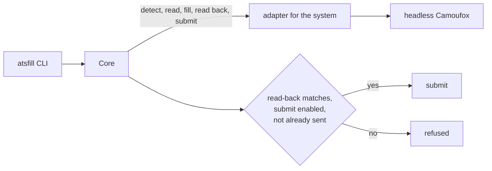

<div align="center">

# atsfill

Fill job application forms from the command line: read, dry-run, then submit.

[![PyPI][pypi-badge]][pypi]
[![Python][python-badge]][pypi]
[![CI][ci-badge]][ci]
[![License][license-badge]][license]

---

[Install](#install) • [Quickstart](#quickstart) • [How it works](#how-it-works) • [Docs](docs/adr/README.md)

---

</div>

atsfill reads the application form behind a job posting, fills it with your answers, and checks what the hiring system will receive before anything is sent.
It is built for agents with a shell: every command prints one JSON document and exits with a code a script can branch on.

- `read` lists a form's fields with their ids, types, options and whether they are required.
- `fill` is a dry run: it fills the form, reads it back field by field, and never submits.
- `send` fills again and submits only when every answer reads back as given.
- Submitting is off until you enable it per hiring system, in a config file the agent does not write.
- A posting already sent is refused unless you pass `--resend`.

## Supported hiring systems

<!-- badges -->
                          
<!-- /badges -->

| System | Account needed | `read` without a browser |
| --- | --- | --- |
| Ashby | no | yes |
| Greenhouse | no | yes |
| Teamtailor | no | no |
| Welcome to the Jungle | yes, `atsfill login wttj` | no |

Any other system returns `unsupported`, so the consumer can fall back to driving a browser itself.

## Why atsfill?

An agent applying through a generic browser carries each system's quirks as prose, rereads it every run, and checks the form before submitting only because an instruction says so.
atsfill moves the quirks into one adapter per system and makes the check code: a `send` whose read-back differs from the answers is refused.

| | Generic browser agent | atsfill |
| --- | --- | --- |
| System quirks | prose in the prompt | an adapter per system |
| Check before submit | an instruction | the read-back must match |
| Permission to submit | whatever the agent decides | a config file, per system |
| Double send | possible | refused without `--resend` |
| Output | page snapshots | one JSON result |

## Install

atsfill runs on Linux, macOS and Windows with Python 3.14, which `uvx` fetches if needed.

```sh
uvx atsfill install-browser
```

This downloads the Camoufox browser build atsfill is pinned to: 1.3 GB, about 2.5 GB once unpacked.

Every push to `main` that passes CI is also published as a dev release; `uvx --prerelease allow atsfill` runs the newest.

## Quickstart

1. List the form's fields:

   ```sh
   uvx atsfill read https://job-boards.greenhouse.io/acme/jobs/1234
   ```

2. Write your answers to `answers.json`, keyed by field id. Files take an absolute path:

   ```json
   {
     "first_name": "Ada",
     "last_name": "Lovelace",
     "email": "ada@example.com",
     "resume": "/home/ada/resume.pdf"
   }
   ```

3. Dry-run the fill. It ends `ready` when every answer reads back as given:

   ```sh
   uvx atsfill fill https://job-boards.greenhouse.io/acme/jobs/1234 --answers answers.json
   ```

4. Allow the system to submit in `~/.config/atsfill/config.toml`:

   ```toml
   submit-allowed = ["greenhouse"]
   ```

5. Send. A `submitted` result carries the evidence of the send:

   ```sh
   uvx atsfill send https://job-boards.greenhouse.io/acme/jobs/1234 --answers answers.json
   ```

A dry run is not invisible: some systems save answers or the resume as they are typed.
`atsfill status` lists each system's side effects, whether it is allowed to submit, and how far atsfill has verified it: [the systems](docs/adapters/README.md).
A dry run or a `send` through an adapter no send was verified on carries a `warning`; the send goes ahead anyway.

One home can send for more than one user: `--user <name>` gives each their own sessions, double-send guard and `[users.<name>]` section in the config file ([ADR 0015](docs/adr/0015-users-and-accounts.md)).
Given an account's email (`atsfill login <adapter> --email`) and a password source (a `[password-commands]` entry such as `rbw get example.com {email}`, or `--password -` on stdin), atsfill signs in by itself, and again whenever a form command finds the session signed out.
Where a system's sign-up allows it, `atsfill login <adapter> --create --email <address>` (with `--name` where the sign-up asks the user's name) creates the account with a password atsfill generates and keeps in the system's secret store, never printed; creating an account is a side effect, never part of `fill` or `send`.

## How it works



Each command launches its own headless Camoufox, a Firefox build patched to hide automation, with a fresh context and one saved device identity.
The core owns every rule about when a send is allowed; an adapter only knows its system's page.

Every result has a `status` (`ready`, `refused`, `submitted`, `blocked`, `unknown`, `unsupported`) and, when it is not clean, a `reason` code.
The exit code is 0 for `ready` and `submitted`, 1 otherwise, 2 for a usage error.

## More

- [Architecture decisions](docs/adr/README.md): the contract, the submit gate, the browser, sessions.
- [Hiring systems](docs/adapters/README.md): every system mapped so far, in backlog order, and each one's form as observed.
- `atsfill --help` for every command and option.

[pypi]: https://pypi.org/project/atsfill/
[pypi-badge]: https://img.shields.io/pypi/v/atsfill?style=for-the-badge&color=7aa2f7&logo=pypi&logoColor=white
[python-badge]: https://img.shields.io/pypi/pyversions/atsfill?style=for-the-badge&color=9ece6a&logo=python&logoColor=white
[ci]: https://github.com/shbernal/atsfill/actions/workflows/ci.yml
[ci-badge]: https://img.shields.io/github/actions/workflow/status/shbernal/atsfill/ci.yml?branch=main&style=for-the-badge&color=bb9af7&logo=githubactions&logoColor=white
[license]: LICENSE
[license-badge]: https://img.shields.io/github/license/shbernal/atsfill?style=for-the-badge&color=e0af68
